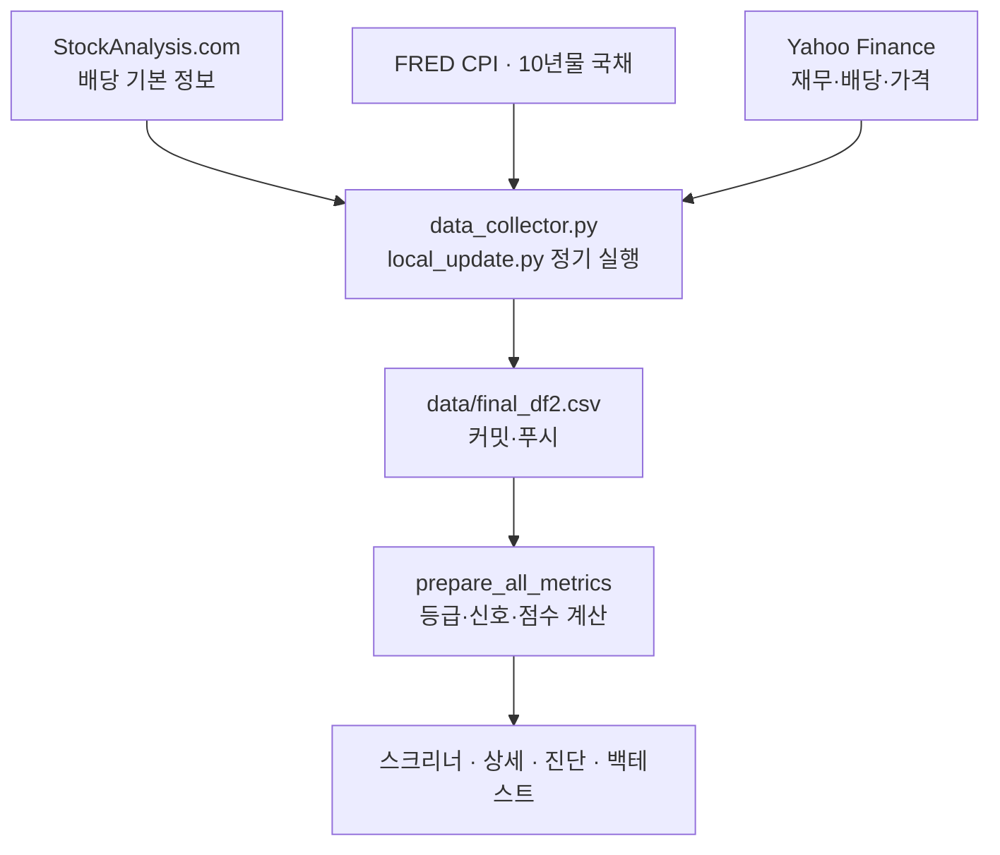
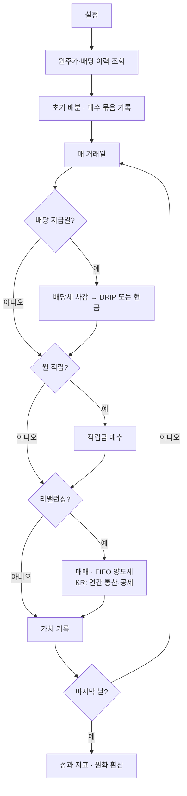

# 배당주 분석 플랫폼


미국 배당주를 거르고, 종목을 분석하고, 보유 포트폴리오를 진단하고, 과거 성과를 백테스트하는 웹 도구입니다.
한국 거주 투자자 기준(세후·원화)으로 계산합니다.

## 좋은 배당주 선정 원칙

| # | 원칙 | 이 도구의 기준 |
|---|---|---|
| 1 | **배당률은 금리보다 높아야 한다** — 위험을 지는 대가가 무위험 이자보다 커야 함 | 고배당: 10년물 국채 3년 평균 이상 (현재 4.33%) · 공통 하한 2% |
| 2 | **배당성장률은 물가보다 높아야 한다** — 실질 배당소득이 줄면 안 됨 | 5년 배당 CAGR ≥ CPI 5년 연환산 (현재 4.06%) · 배당성장: Chowder Rule |
| 3 | **배당은 오래, 꾸준히 늘려온 기업** — 이력이 짧은 고배당은 위험 | 연속 배당 증가 5년 이상 (배당성장 10년) · 2000·2008·2020 위기 통과 여부 표시 |
| 4 | **배당은 이익과 현금흐름에서 나와야 한다** | 섹터별 배당 커버리지·부채·이자보상 기준 · 적자·3년 연속 매출 감소 탈락 |
| 5 | **삭감 이력은 가장 강한 경고** | 최근 10년 삭감 감지 · 삭감 후 회복의 착시를 걷어낸 보정 성장률 |
| 6 | **싸게 사되, 싼 이유를 의심한다** — 높은 배당률은 기회이자 함정 | 배당률 5년 백분위로 저평가·고평가 표시 · 실적 악화 동반 시 "함정 의심" |
| 7 | **종목이 아니라 포트폴리오로 본다** | 종목 소득 20%·섹터 35% 집중 경고 · 월별 배당 공백 점검 |
| 8 | **세후·원화로 계산한다** | 미국 배당 원천징수 15% · 양도세 22%(연 ₩250만 공제) · 금융소득 종합과세 ₩2,000만 경고 |

- 섹터 특성을 반영합니다 — 리츠·MLP는 배당성향 대신 영업현금흐름 커버리지, 유틸리티·리츠는 높은 부채 허용, 은행은 배당성향으로만 평가
- 기준별 수치와 이유 전체: [배당투자 기준서](docs/investment_criteria.md)

---

## 목차

- [좋은 배당주 선정 원칙](#좋은-배당주-선정-원칙)
- [설치 및 실행](#설치-및-실행)
- [데이터 갱신](#데이터-갱신)
- [웹 사용법](#웹-사용법)
  - [홈](#홈)
  - [고배당 스크리너](#고배당-스크리너)
  - [배당성장 스크리너](#배당성장-스크리너)
  - [종목 상세분석](#종목-상세분석)
  - [포트폴리오 백테스트](#포트폴리오-백테스트)
  - [포트폴리오 진단](#포트폴리오-진단)
- [기술 문서](#기술-문서)

---

## 설치 및 실행

```bash
python -m venv .venv
.venv/Scripts/python.exe -m pip install -r requirements.txt
.venv/Scripts/streamlit.exe run app.py
```

브라우저에서 `http://localhost:8501`이 열립니다.

## 데이터 갱신

**최신 데이터 받기**: 저장소를 pull 하면 됩니다.

```bash
git pull origin main
```

**갱신 방식**: 로컬 PC에서 `local_update.py`를 Windows 작업 스케줄러로 정기 실행합니다.

- 순서: `git pull` → 수집·가공·보강 → 데이터 파일 커밋·푸시
- GitHub Actions는 수동 실행만 남겨 둠 — 데이터 사이트(StockAnalysis.com)가 클라우드 IP를 차단하기 때문
- 수동 실행: `.venv/Scripts/python.exe local_update.py`

**갱신 기록과 알림**

- 모든 실행 결과가 `data/update_history.csv`에 남습니다 (성공·부분 실패·실패, 종목 수, 오류)
- 실패하거나 종목 10% 넘게 보강에 실패하면 텔레그램으로 알립니다. git pull/push 실패도 알립니다
  - 환경변수 `TELEGRAM_BOT_TOKEN`, `TELEGRAM_CHAT_ID` 설정 시에만 동작
- 데이터가 **4일** 넘게 갱신되지 않으면 모든 화면 상단에 경고와 최근 실패 원인이 표시됩니다

---

# 웹 사용법

## 홈

**데이터 소스 선택 (사이드바)**

- **기존 데이터 사용 (기본값)**: `data/final_df2.csv`를 바로 불러옵니다. 마지막 갱신 시각(미국 동부시간) 표시
- **최신 데이터 수집 (로컬 전용, 3~5분)**: 브라우저 자동화로 직접 수집합니다. 급할 때만 사용

**데이터셋**: 기준을 통과한 약 380개 종목의 원본 지표 표. 컬럼 헤더 클릭으로 정렬, 마우스 오버로 설명 확인.

---

## 고배당 스크리너

**목적**: 지금 받는 배당이 금리보다 높고, 물가보다 빨리 늘며, 이익·현금흐름으로 감당되는 종목 찾기

### 필터

| 항목 | 기본값 | 비고 |
|---|---|---|
| 최소 배당률 | **10년물 국채 3년 평균** (현재 4.33%) | 하한 2%. 데이터 갱신 때 자동 반영 |
| 배당성향 범위 | 20–70% | 일반·에너지만. 섹터별 예외는 아래 |
| 연속 배당 증가 / 무삭감 연수 | 5년 / 5년 | |
| 1년 배당성장률 | 3% | |
| 5년 배당 CAGR | **CPI 5년 연환산** (현재 4.06%) | 삭감 후 회복 기저효과를 보정한 값 기준 |
| 최소 ROE | 0% | 음수 ROE(자사주 매입으로 자본이 음수)는 통과. 리츠·MLP 면제 |
| 섹터 / 시가총액 등급 | 전체 | 다중 선택 |

**항상 적용되는 탈락 기준** (사이드바 "Sector-specific gates"에서 확인)

- 섹터별 부채(순부채/EBITDA)·이자보상배율·배당 커버리지 기준
  - 유틸리티 배당성향 ≤ 80%, 은행·기타 금융 ≤ 60%
  - 리츠·MLP는 배당성향 대신 **영업현금흐름/배당 ≥ 1.2배**
- 적자(최근 12개월 EPS ≤ 0) — 리츠·MLP 면제
- **3년 연속 매출 감소**
- 데이터가 없는 항목은 "알 수 없음"으로 통과

### 점수

- 배당률 **50%** · 5년 배당 CAGR **25%** · 배당 커버리지 **25%** (합계 100%, 조정 가능)
- 각 지표를 전체 유니버스 안에서 **백분위**로 환산해 가중합 → 0~100점
- 부채·배당성향·이익 같은 건전성 지표는 점수가 아니라 탈락 기준으로 처리 — 배당률이 아무리 높아도 위험 신호를 덮을 수 없음

### 결과

- 점수 순 상위 50개 표 + CSV 다운로드
- 기본 표시 열

| 열 | 의미 |
|---|---|
| `Alert` | 배당률 10% 초과 — 주가 급락 여부 확인 필요 |
| `Yield_Trap` | 수익률 함정 의심 (저평가인데 이익 감소·커버리지 < 1·삭감 이력) |
| `Safety_Grade` | 배당 안전성 A–F |
| `Valuation` | 저평가 / 적정 / 고평가 (현재 배당률의 5년 백분위 기준) |
| `Timing_Signal` | 과매도 / 20일선 아래 (참고용) |
| `Div_Coverage` | 섹터에 맞는 배당 커버리지 (배) |
| `Crisis_Passed` | 배당을 계속 늘리며 지나온 위기 (2000·2008·2020) |
| `Growth_Badge` | 매출·이익 동반 성장 |
| `Shareholder_Yield` | 배당률 + 순 자사주 매입 수익률 |

- 차트: 배당률 vs 연속 증가 연수 버블, 상위 10개 막대, 배당률 분포

---

## 배당성장 스크리너

**목적**: 지금 배당률은 낮더라도 배당이 빠르게, 오래 늘어날 종목 찾기

### 고배당 스크리너와 다른 점

| 항목 | 고배당 | 배당성장 |
|---|---|---|
| 최소 배당률 | 국채 3년 평균 | **2%** |
| 연속 증가 / 무삭감 연수 | 5 / 5년 | **10 / 10년** |
| 1년 배당성장률 | 3% | **5%** |
| 5년 배당 CAGR | CPI | **max(5%, CPI)** |
| 배당성향 범위 | 20–70% | **15–60%** (성장 여력) |
| 최소 ROE | 0% | **8%** |
| Chowder Rule | — | **적용 (기본 켜짐)** — 배당률 ≥ 3%면 12 이상, 미만이면 15 이상 |
| 시가총액 ≥ $200억 | — | 선택 (기본 꺼짐) |
| 점수 가중치 | 배당률 50 · CAGR 25 · 커버리지 25 | **CAGR 60 · 배당률 40** |

- Chowder Number = 배당률(%) + 보정 5년 배당 CAGR(%)
- 섹터별 탈락 기준은 고배당 스크리너와 동일

### 결과

- `EPS_Alert`: 5년 배당 CAGR이 3년 EPS CAGR보다 높음 — 이익보다 배당이 빨리 늘어 배당성향이 커지는 중
- 그 외 열은 고배당 스크리너와 같음 (`chowder_number`, `EPS_CAGR_3Y`, `Revenue_CAGR_3Y` 추가)
- 차트: 배당률 vs 5년 CAGR 버블, 상위 10개, 5년 CAGR 분포

---

## 종목 상세분석

**목적**: 한 종목의 배당 지속성·가격 수준을 한 화면에서 판단

**상단 지표**: 배당률, 연간 배당금, 배당성향, 연속 증가·지급 연수, 1년·5년 성장률, 시가총액 등급

**재무 건전성 (20개 지표)**

| 묶음 | 지표 |
|---|---|
| 안전성 | 안전성 등급, 배당 커버리지, 순부채/EBITDA, 이자보상배율, 위기 통과 수 |
| 성장 | 보정 5년 배당 CAGR, 매출 3년 CAGR, EPS 3년 CAGR, ROE, 최근 12개월 EPS |
| 가격 수준 | 밸류에이션, 배당률 5년 백분위, P/FCF |
| 매수 시점 | 20일 이동평균 대비, RSI(14), MFI(14), 시점 신호 (데이터 갱신일 기준) |
| 주주환원 | 주주환원수익률, 순 자사주 매입 수익률, 3년 주식 수 변화 |

- 섹터 그룹과 적용되는 커버리지 기준을 함께 표시
- 경고: 최근 10년 배당 삭감, 수익률 함정, 이익 대비 배당 과속
- 배지: 위기 통과 이력, 매출·이익 동반 성장
- 안전성 등급 구성 요소별 점수 표시

**탭**

1. **가격·배당률 이력**: 기간 선택(1년~전체), 이동평균선, 배당률 추이와 평균·중앙값·최저·최고
2. **배당 이력**: 다음 배당락일·지급일, 최근 지급 내역, 연간 배당금 차트 — 삭감·중단 여부 확인
3. **기업 정보**: 섹터·산업, 시가총액, 사업 설명

---

## 포트폴리오 백테스트

**목적**: 과거 데이터로 배당 포트폴리오의 세후·원화 성과 시뮬레이션

### 설정

- **종목**: 최대 20개 / 배분 방식: 동일 비중, 사용자 지정, 배당률 비중, 시가총액 비중
- **기간·투자금**: 시작·종료일, 초기 투자금(기본 $10,000), 월 적립금
- **배당 재투자(DRIP)**: 켜기/끄기, 수수료, 소수점 주식 매수
- **세금**: 프리셋 선택 후 개별 세율 조정 가능

| 프리셋 | 배당 | 양도차익 | 비고 |
|---|---|---|---|
| **한국 거주자 (기본)** | 15% (미국 원천징수) | 22% | 연 **₩250만** 공제, 같은 해 손익 통산 |
| 미국 거주자 | 적격 15% / 일반 22% | 15% | |

- **원화 보기**: 켜면 원화 기준 결과 추가
- **리밸런싱**: 빈도(안 함·월·분기·반기·연), 수수료(기본 0.1%), 편차 기준(기본 5%)

### 결과

- **생존편향 경고**: 오늘의 목록에서 고른 종목은 과거 성과가 부풀려질 수 있음 — 항상 표시
- **성과 지표**: 최종 가치, 총 배당, CAGR, 샤프·소르티노·칼마 비율, 최대 낙폭, 베타·알파, 변동성, VaR(95%), 벤치마크(SPY) 대비, 승률
  - 무위험수익률 = 백테스트 기간의 **실제 3개월 국채 금리 평균** (예: 2018~2025년 2.54%)
- **원화 기준**: 원화 평가액·총수익률·CAGR, 환율 변화, 연도별 원화 배당소득
  - 연 배당소득이 금융소득 종합과세 기준(**₩2,000만**)을 넘는 해는 경고 (종합과세 세액 자체는 계산하지 않음)
- **차트 탭**: 자산 성장(DRIP 유무, 벤치마크), 배당 소득, 낙폭, 세금 영향
- **상세 내역**: 보유 종목, 리밸런싱 내역(수수료·세금), CSV 내보내기

**계산 방식**

- 가격은 배당 미반영 원주가 사용 → 배당은 실제 지급일에 현금 또는 재투자로 한 번만 반영
- 양도세는 매수 묶음별 선입선출(FIFO)로 계산 — 매도한 수량만큼만 과세

---

## 포트폴리오 진단

**목적**: 지금 보유한 포트폴리오의 배당 소득과 위험 신호를 한 번에 점검

**입력**: 표에 종목·수량 입력, 또는 한 줄에 `종목 수량`으로 붙여넣기 (예: `KO 100`, 쉼표·탭 구분 가능)

- 스크리너 유니버스에 없는 종목(ETF 포함)도 실시간 조회

**결과**

- **요약**: 평가액, 예상 연 배당(세전·세후 15%), USD·KRW, 포트폴리오 배당률, 소득 가중 5년 배당성장률
- **보유 종목 표**: 평가액·소득 비중, 안전성 등급, 밸류에이션, 시점 신호, 삭감·함정, 위기 통과, 동반 성장
- **월별 배당 캘린더**: 최근 12개월 배당락일 × 현재 수량
- **섹터 집중도**: 평가액·소득 비중 (ETF는 별도)
- **안전성 등급별 소득 비중**

**주의 신호 (자동)**

| 신호 | 조건 |
|---|---|
| 종목 소득 집중 | 한 종목이 배당소득의 20% 초과 |
| 섹터 집중 | 한 섹터가 평가액의 35% 초과 (ETF 제외) |
| 안전성 취약 | D·F·N/A 등급이 배당소득의 25% 초과 |
| 삭감 이력 / 수익률 함정 | 해당 종목 보유 |
| 배당 없는 달 | 최근 12개월 기준 |
| 금융소득 종합과세 | 예상 연 배당 ₩2,000만 초과 (다른 금융소득과 합산 기준) |

---

# 기술 문서

개발자용 상세(모듈 API, 주의사항)는 [CLAUDE.md](CLAUDE.md), 판단 기준은 [배당투자 기준서](docs/investment_criteria.md)를 참고하세요.

## 디렉토리 구조

```
dividend/
├── app.py                          # 홈 (데이터 소스 선택, 데이터셋)
├── config.py                       # 모든 기준값·설정 (수치의 원본)
├── local_update.py                 # 정기 데이터 갱신 + git 커밋·푸시
├── docs/
│   └── investment_criteria.md      # 배당투자 기준서
├── pages/
│   ├── 1_High_Dividend_Screener.py
│   ├── 2_Dividend_Growth_Screener.py
│   ├── 3_Stock_Details.py
│   ├── 4_Portfolio_Backtest.py
│   └── 5_Portfolio_Diagnosis.py
├── modules/
│   ├── data_collector.py           # 갱신 파이프라인 (수집·필터·보강·저장)
│   ├── dividend_metrics.py         # 종목별 yfinance 지표 계산
│   ├── macro_benchmarks.py         # 국채 금리·CPI 기준값
│   ├── data_processor.py           # 파생 지표·필터·점수·등급·신호
│   ├── portfolio_diagnosis.py      # 보유 포트폴리오 진단
│   ├── portfolio_backtester.py     # 백테스트 엔진
│   ├── update_log.py               # 갱신 기록·텔레그램 알림
│   └── visualization.py            # Plotly 차트
├── utils/
│   ├── cache_manager.py            # 캐시·준비된 데이터 로드·갱신 경고
│   └── data_loader.py
└── data/
    ├── final_df2.csv               # 앱 데이터셋 (~380종목)
    ├── dividend_from_stockanalysis.csv  # 원본 수집 데이터 (~5,700종목)
    ├── macro_benchmarks.json       # 국채 금리·CPI 기준값
    ├── update_history.csv          # 갱신 기록
    └── ...                         # 배당 귀족·왕족·SCHD 목록, 백업
```

## 데이터 흐름



## 갱신 파이프라인

| 단계 | 내용 |
|---|---|
| 0 | 기존 데이터 백업, 국채 금리 3년 평균·CPI 5년 연환산 갱신 |
| 1 | StockAnalysis.com 수집 (또는 기존 원본 재사용), 1,000종목 미만이면 중단 |
| 2 | 유니버스 필터: 배당률 ≥ 2%, 연속 증가 ≥ 5년, 1년 성장 ≥ 3%, 5년 CAGR ≥ CPI. 배당 귀족·왕족·SCHD 편입 종목은 예외 |
| 2.5 | 누락된 귀족·왕족·SCHD 종목 추가, 분류 태그 |
| 3 | Yahoo Finance 보강 (병렬 + 실패 재시도). 실패 목록은 `enrichment_failures.csv` |
| 4 | 과거 배당률 대비 차이 열 추가 (필터 아님) |
| 5 | 저장, 갱신 시각 기록 |

## 핵심 알고리즘

### 배당 지표 계산 (`dividend_metrics.py`)

- **연간 배당**: 최근 f회 정기 배당 합 (f = 최근 5년 연간 지급 횟수 중앙값)
  - 특별배당(평소의 1.5배 초과) 제외
  - 365일 창은 쓰지 않음 — 지급일이 밀리면 분기 배당이 5번 잡힐 수 있음
- **배당률 밴드**: 원주가(배당 미반영) 기준 일별 배당률의 5·10년 평균·최저·최고, 현재 배당률의 5년 백분위
  - 지급이 1.5회 주기 이상 끊기면 배당률 0으로 처리
- **배당 삭감 감지**: 회차별 전년 대비 + 연도별 합계, 두 방법이 같은 시기(±1년)에 10% 넘는 감소를 잡아야 삭감
  - 연속 증가 10년 이상이면 삭감 없음으로 확정
- **보정 5년 CAGR**: 연속 증가 10년 미만이면 min(제공처 5년 CAGR, 고점 기준 5년 CAGR) — 삭감 후 회복 기저효과 제거
- **커버리지**: FCF/배당, 영업현금흐름/배당 모두 **3년 평균**
- **매수 시점 지표**: 20일 이동평균 대비, RSI(14, Wilder), MFI(14)

### 필터와 점수 (`data_processor.py`)

1. 전체 유니버스에 파생 지표 계산 (섹터 그룹, 보정 CAGR, 커버리지, 등급, 신호, 백분위)
2. 탈락 기준 적용 (배당 기준 + 섹터별 기준 + 적자·ROE·매출 추세)
3. 통과 종목 점수 = Σ(지표 백분위 × 가중치) × 100

```
백분위: 유니버스 내 순위 / 종목 수 (결측 = 0.5)
점수:   Σ(백분위 × 가중치) × 100
```

- 백분위는 **거르기 전 전체 유니버스**에서 계산 — 필터 조건을 바꿔도 같은 종목의 백분위는 그대로

### 안전성 등급

- 커버리지·부채·이자보상·삭감 이력·이익 안정성 각 0–2점 + 2008 위기 통과 가점
- 받은 점수 비율: A ≥ 85% · B ≥ 70% · C ≥ 55% · D ≥ 40% · F 미만, 요소 3개 미만이면 N/A
- 구간별 세부 기준은 [기준서 §7](docs/investment_criteria.md#7-안전성-등급-af)

### 백테스트 엔진 (`portfolio_backtester.py`)



## 데이터 스키마 (주요 열)

### StockAnalysis.com (수집)

| 열 | 의미 |
|---|---|
| `Div. Yield` | 배당률 (소수, 0.05 = 5%) |
| `Div. ($)` | 연간 배당금 (주당) |
| `Payout Ratio` | 배당성향 |
| `Div. Growth` / `Div. Growth 5Y` | 1년 배당성장률 / 5년 CAGR |
| `Div. Gr. Years` / `Div. Years` | 연속 배당 증가 연수 / 연속 지급 연수 |
| `Market Cap` | 시가총액 (문자열, 예: `911.47B`) |

### Yahoo Finance (보강, `dividend_metrics.py`)

| 열 | 의미 |
|---|---|
| `Sector`, `Industry` | 섹터 그룹 분류에 사용 |
| `Net_Debt_EBITDA` | (총부채 − 현금) / EBITDA. 음수 = 순현금, EBITDA ≤ 0이면 99 |
| `Interest_Coverage` | EBIT / 이자비용 |
| `FCF_Dividend_Ratio` / `OCF_Dividend_Ratio` | 3년 FCF·영업현금흐름 / 배당 지급액 |
| `Revenue_CAGR_3Y` / `EPS_CAGR_3Y` | 매출·EPS 3년 CAGR |
| `Revenue_Decline_Years` | 최근부터 센 연속 매출 감소 연수 |
| `EPS_CV` | EPS 변동계수 (이익 안정성) |
| `ROE` | 자기자본이익률 (**% 단위**, 15.0 = 15%) |
| `Trailing_EPS` | 최근 12개월 EPS (적자 판정) |
| `P_FCF`, `Net_Buyback_Yield`, `Shares_Change_3Y` | 가격 대비 FCF, 순 자사주 매입 수익률, 3년 주식 수 변화 |
| `Yield_TTM`, `Yield_Pctl_5Y` | 현재 배당률, 5년 백분위 |
| `Trainling_5Y/10Y_avg/min/max_dividend_yield` | 배당률 밴드 |
| `Div_Cut_Detected`, `Div_Last_Cut_Year`, `Div_CAGR_5Y_Peak` | 삭감 감지, 마지막 삭감 연도, 고점 기준 5년 CAGR |
| `Price_vs_MA20`, `RSI_14`, `MFI_14`, `Timing_As_Of` | 매수 시점 지표와 기준일 |

### 파생 (불러올 때 계산, `data_processor.py`)

| 열 | 의미 |
|---|---|
| `Sector_Group` | general · energy · utility · reit · mlp · bank · financial |
| `Div_CAGR_5Y_Adj`, `Cut_Flag` | 보정 5년 CAGR, 삭감 플래그 |
| `Div_Coverage`, `Coverage_Basis` | 섹터에 맞는 커버리지와 기준 (fcf/ocf/eps) |
| `Safety_Grade`, `Safety_Score`, `Safety_Detail` | 안전성 등급·점수·요소별 점수 |
| `Valuation`, `Yield_Trap` | 밸류에이션 신호, 함정 의심 |
| `Crisis_Passed`, `Crisis_Count` | 통과한 위기 |
| `Growth_Badge`, `Timing_Signal`, `EPS_Alert` | 동반 성장, 시점 신호, 이익 대비 배당 과속 |
| `chowder_number`, `Shareholder_Yield` | Chowder Number, 주주환원수익률 |
| `high_div_composite`, `dividend_growth_composite` | 스크리너 점수 (0–100) |

## 기술 스택

Streamlit · pandas/NumPy · Selenium · yfinance · Plotly · FRED (CPI)

---

**데이터 출처**: [StockAnalysis.com](https://stockanalysis.com/) · [Yahoo Finance](https://finance.yahoo.com/) · [FRED](https://fred.stlouisfed.org/)

**면책**: 교육·정보 목적의 도구이며 투자 권유가 아닙니다. 세금 계산은 일반 기준이므로 실제 신고는 세무 전문가와 확인하세요.
